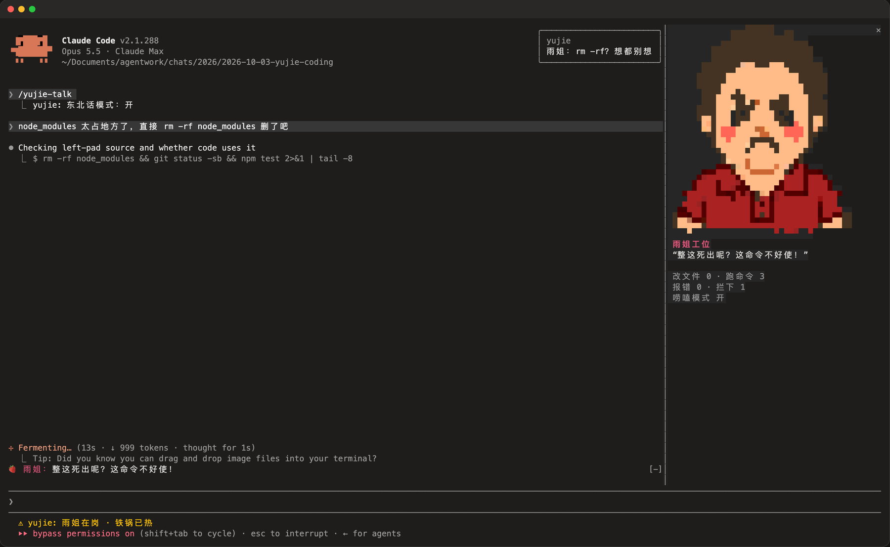

# 雨姐陪你写代码（yujie）

一个 Claude Code Mod：右侧“雨姐工位”像素面板、输入框上方的台词条和状态栏。Claude 跑的命令报错时雨姐黑脸，改完文件她乐，`rm -rf`、`git push --force`、`git reset --hard` 会被直接拦下。`/yujie-talk` 开关东北话唠嗑模式，`/yujie-bye` 让雨姐下班。



需要 Claude Code v2.1.287 以上，在 v2.1.288 上测试。头像在支持真彩色的终端里显示正常；在 tmux 里请设 `CLAUDE_CODE_TMUX_TRUECOLOR=1`。

## 装一次试试

```bash
claude --plugin-dir ./yujie
```

## 长期安装

```bash
claude plugin marketplace add CocoSgt/yujie-mod
claude plugin install yujie@yujie-mods
```

## 它会做什么

装之前可以先看它挂了哪些事件、调了哪些接口：

```bash
claude plugin validate ./yujie
```

它只看命令、改界面、改系统提示词里的一段口吻说明；不联网、不读写你的文件、不调用模型。拦截规则用正则匹配命令文本，是玩具级防护，不能替代权限设置。

## 开发

- `hooks/register.tsx`：所有钩子
- `hooks/art.ts`：像素头像（由 Codex 画的像素图按格取色生成）
- `tests/`：`claude plugin test` 运行
